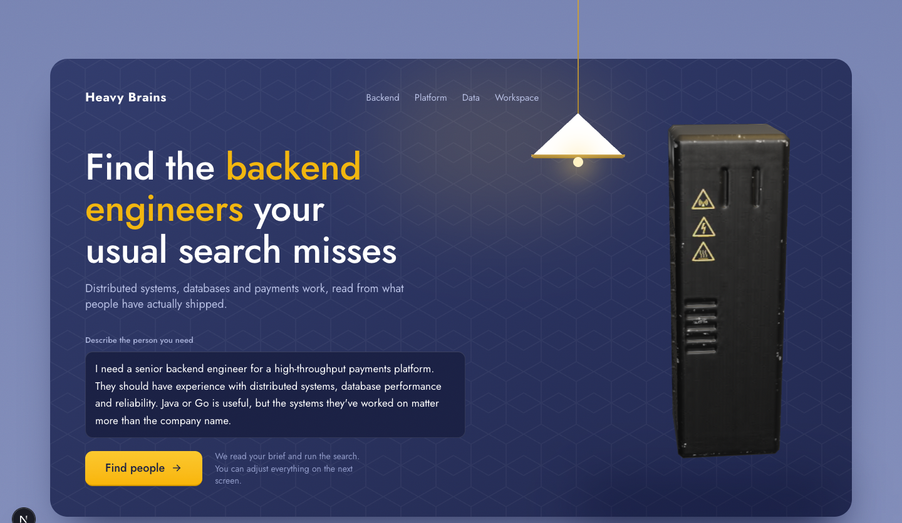
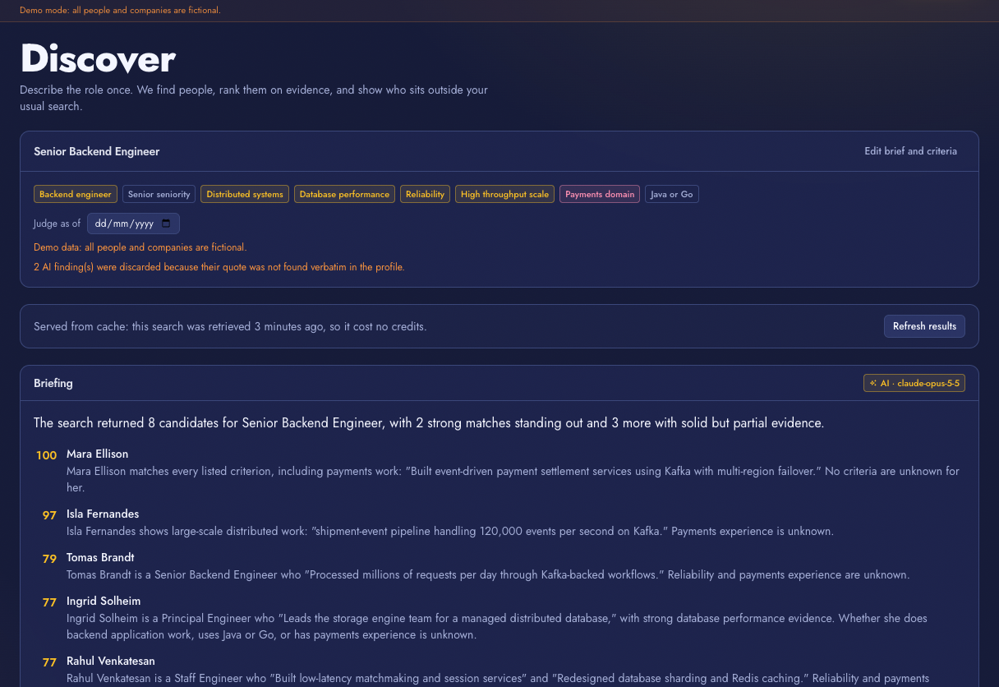
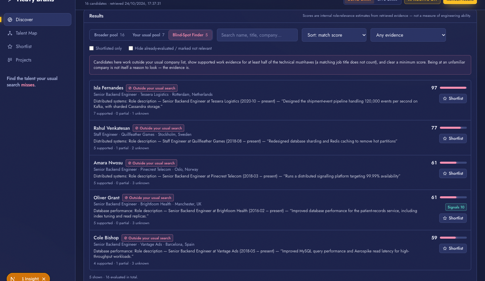
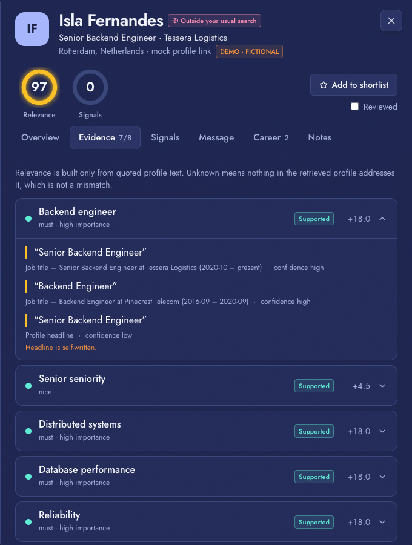
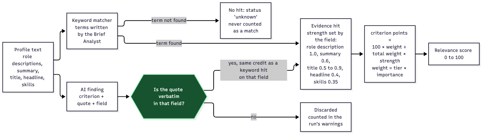

# Heavy Brains

**Hand it a hiring brief. Get back the few people worth a call, each with the exact profile text that put them there, plus the strong candidates your usual search would never have looked at.**



---

## The service

**The job:** technical sourcing. Turning a hiring brief into a short, justified list of people to contact.

**Who does it today:** in-house recruiters and sourcers, agency recruiters, freelance sourcers, and hiring managers who source for themselves.

**Who pays:** the employer, either through a talent team's salary budget or through an agency that is paid when someone is hired.

**Where they slip:**
- They search the same few well-known companies, so good people elsewhere are never seen.
- They search by keyword and job title, and miss people who describe the same work in different words.
- They can't check claims quickly, so a ranking is a hunch rather than something they can defend.

Heavy Brains attacks all three: it searches wider, reads profiles for meaning, and refuses to rank anyone on something it can't quote.

---

## What it does now



One brief goes in. About a minute later you get a ranked list. The run is automatic from the moment you press **Find people**:

1. **Reads the brief**, including a full pasted job posting, and turns it into criteria and search terms.
2. **Searches Crustdata** for people and their employers, with extra job titles you didn't think of.
3. **Pulls fuller profiles** for the top 10 (career history, education, funding stage and team size of their employers, matched GitHub account).
4. **Reads every profile for proof** the keywords missed. A finding counts only if its quote appears word for word in the profile.
5. **Scores 0 to 100** from quoted text only. Anything not shown in a profile stays "unknown" and is never treated as a match.
6. **Writes a briefing** of the top picks with quotes, and flags people **outside the companies you usually search**.
7. **Drafts a first message** per candidate that opens with their real work. It never sends.

| People outside your usual companies | The quote behind every score |
|:--|:--|
|  |  |

![A drafted first message that quotes the candidate's real work and keeps [your name] placeholders](docs/images/card-message.png)

**Where a person still has to step in**
- Deciding who to contact, and sending the message (the app drafts, it never sends).
- Confirming claims in a conversation. Profile text is self-reported.
- Scheduling and any ATS work. Neither is built.

### Metrics used to rank people

| Kind | What it measures |
|---|---|
| **Relevance (0 to 100)** | How much of your brief the profile proves, weighted by must/nice/context and importance. Role descriptions count most, skills lists least. |
| **Career signals** (own 0 to 100) | Startup veteran (years at pre-seed or seed-stage teams with 15 or fewer engineers), joined companies while young, rehired by the same company, fast promotion, lean-team employers, repeat contract hires, competitor experience, open-source impact (stars × merged PRs per repo, from GitHub). |
| **Optional** | An AI review of the quality of what someone posts on LinkedIn, run on request because it costs credits. |

Signals that can't be checked are left out of the score, not counted as zero. The landing page explains each one.

---

## Try it

Paste this into the box on the landing page:

> We need a founding backend engineer in Bengaluru who has shipped payments systems at a startup. Find me five people worth a call this week, and tell me why each one fits.

On our last live run this took about a minute and about 150 Crustdata credits. Repeating it within 24 hours is served from a cache and costs nothing.

No keys? Choose **DEMO DATA** in the header. It runs the whole product on a fictional dataset (every screenshot here is from it).

---

## How it's built


Plain TypeScript runs the agents in order and in parallel. No agent chooses its own next step. Full diagrams are in [`docs/ARCHITECTURE.md`](docs/ARCHITECTURE.md).

| Part | Detail |
|---|---|
| **Agents** | Brief Analyst, Search Strategist, Evidence Reviewers (parallel, 5 profiles per call), Briefing Writer, Outreach Writer, Content Reviewer. Model: `claude-opus-5-5` by default. |
| **Scoring** | Not a model. A deterministic engine in the browser, so changing a criterion re-ranks instantly. |
| **Guards** | Any quote must appear verbatim in the profile or it is discarded. Briefing and message drafts are checked the same way. |
| **State** | Projects live in the browser's `localStorage`. The server keeps only a 24-hour result cache. |
| **Stack** | Next.js 16, TypeScript, Tailwind 4, Motion, three.js. |



### Where it calls Crustdata

| Endpoint | Used for | Cost |
|---|---|---|
| `/person/search` | The candidate pool, several queries per search | 0.03 credits per profile, plus field groups |
| `/company/search` | Employer profiles, founding year, size | 0.03 per company |
| `/person/enrich` | Top 10: full dated career, education, summary, matched GitHub account | about 1 to 2 per person |
| `/company/enrich` | Their employers: funding stage, engineers on the team | about 2 per company |
| `/social_post/search` | Optional post-quality review, one person at a time | 0.5 per post |

Not used: Job Search, Watcher, Web Search, the MCP server. Details and limits we found are in [`docs/crustdata-integration.md`](docs/crustdata-integration.md).

---

## How to run it

```bash
npm install
cp .env.example .env     # fill in the keys you have; all are optional
npm run dev              # http://localhost:3000
```

| Key in `.env` | Turns on | Without it |
|---|---|---|
| `CRUSTDATA_API_KEY` | Live people search, enrichment, post review | Demo mode (fictional data) |
| `ANTHROPIC_API_KEY` | The agents and message drafts | Keyword rules only |
| `GITHUB_TOKEN` | Open-source signal. A token with **no scopes** is enough. | That signal stays unchecked |

The header always shows `LIVE` or `DEMO`, and `AI AGENTS ON` or `OFF`. Nothing switches silently.

```bash
npm test        # 133 tests
npm run build
```

---

## How we tested it

- **133 automated tests** using a fake model and fake network calls: fabricated quotes, wrong fields, failed batches, failed keys, the cache, as-of replay, scoring.
- **Live runs** of the full pipeline on a real job posting and on the Bengaluru brief above.
- **Regression runs on real output.** These caught several bugs the unit tests missed (see the table below).

| Checked | Result |
|---|---|
| Full live search, AI on, enrichment on | about 60 seconds, about 152 credits, 5 picks with quotes |
| Same search again | 0.0 seconds, 0 credits (cache hit) |
| Post-quality review | Run on 5 real candidates: 1 judged, 4 had too few posts and were skipped at no cost |
| GitHub open-source signal | 7 of the top 10 had a matched account; activity fetched for all 7 |
| Outreach draft | Run on a real candidate: opens with their work, quote checked |
| **Not measured** | **Ranking accuracy against known hires.** We have no benchmark and don't claim a hit rate. |
| **Not connected** | Pay estimates (no salary source), patents, citations, products with users, closed companies |

---

## Approaches we tried

| Approach | What worked | What didn't |
|---|---|---|
| **Keyword rules only** | Fast, free, explainable. Still the no-key fallback. | Knew about 14 software terms. Couldn't read a real job posting. |
| **LLM scores every profile** | Would read profiles well. | Never built. Scores can't be audited, and a model will invent a flattering quote. |
| **LLM finds evidence, a formula scores it** *(what we built)* | Every point traces to a quote. Live: 34 quoted findings on one search, anything unquoted dropped. | The quote check first rejected valid quotes over a full stop vs a comma (3 of 5 picks lost). Fixed without loosening the wording match. |
| **GitHub activity formulas** | Stars × merged PRs per repo works and is live. | One PR into a 56,000-star beginners' practice repo scored near the top, and self-merged PRs inflated scores. We ignore practice repos and cap self-merged PRs. A single PR into a huge project still scores well. |
| **Supabase as a data store for GitHub data** | – | Hit an error we couldn't get past in time. We call GitHub and Crustdata directly instead. |
| **Salary from salary portals** | – | Ranges for the same person were far apart across sources. Nothing trustworthy, so salary is not in the ranking. |
| **"Startup veteran" metric** | Funding stage and engineer count from Company Enrich make it measurable. | Wrong three times on real data: it added up overlapping roles, counted one-person shells, then excluded real startups that LinkedIn labels "Self-Employed". |
| **A fix that broke the briefing** | – | Telling the model "never write internal ids" left each pick's id field empty, so all five picks vanished. Tests passed because the fake model always sent valid ids. A live run caught it. |
| **Autonomous recruiter that also sends** | – | Left out: sending needs consent and double-send protection. |

---

## What we left out, and what's next

| Left out | Why not now |
|---|---|
| Sending messages | Needs consent handling and a guarantee nobody is contacted twice. Drafting exists. |
| A ranking benchmark on known hires | The as-of replay (judge people using only what was knowable on a date) is the groundwork. We haven't built or run the benchmark. |
| Job Search and Watcher | A standing search that alerts you when a shortlisted person moves is the natural next step. |
| Headcount over time | Company Enrich returns a time series we haven't used. It would fix "team size today, not then". |
| Patents, citations, products with users | Need a data source we don't have. Scoring logic and tests exist. |
| Accounts and a database | State is per-browser. Fine for one recruiter, not for a team. |

## Where this is heading

Sourcing becomes continuous instead of a project. An agent keeps a standing brief, notices when someone becomes a fit, writes to them, and hands a person a complete file. The recruiter's job shifts from searching to judgement: who to trust and how to win them. The rule that makes that safe stays the same: **no claim without a quote a person can check.**

---

3D models are from Sketchfab under CC BY and credited on the pages. More: [`docs/ARCHITECTURE.md`](docs/ARCHITECTURE.md) · [`docs/BUILD-NOTES.md`](docs/BUILD-NOTES.md) · [`docs/crustdata-integration.md`](docs/crustdata-integration.md)
