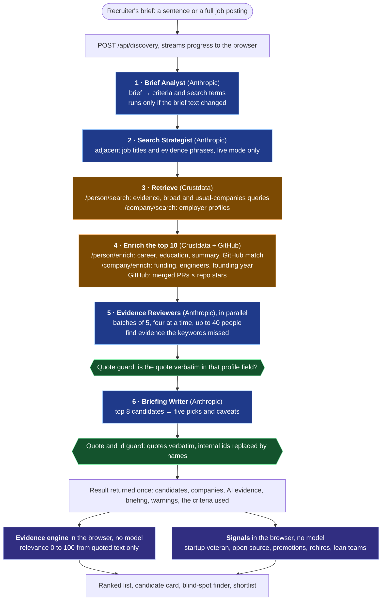
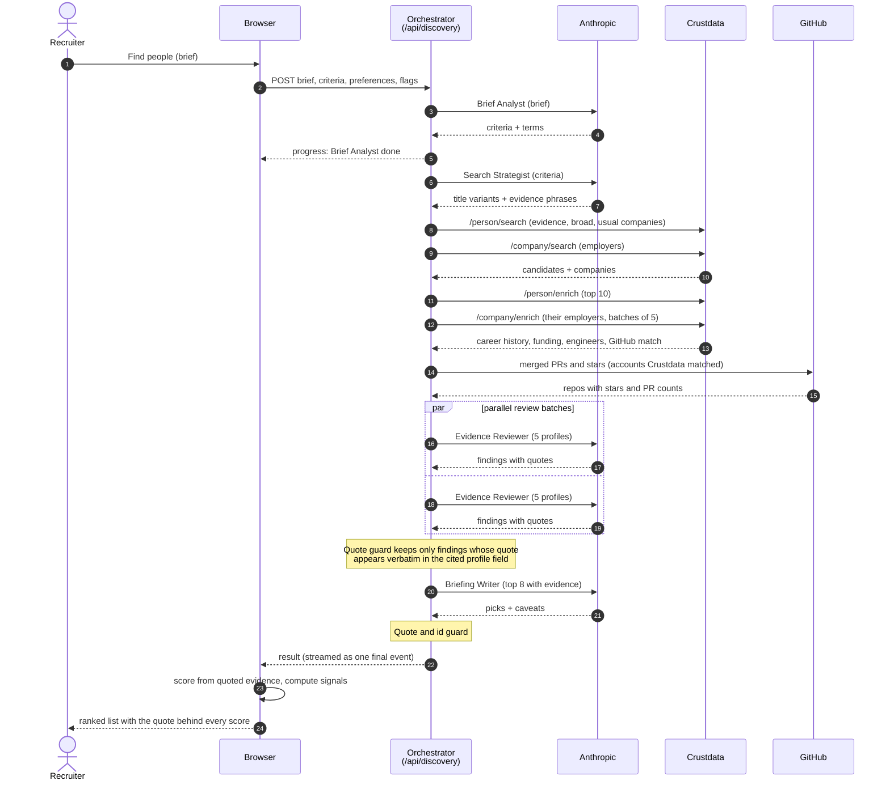
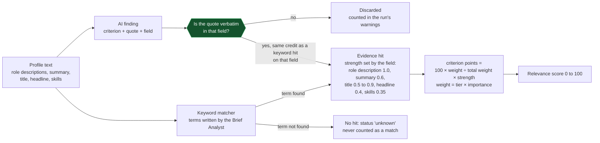

# Multi-agent orchestration

Heavy Brains runs a team of specialist agents, but **plain TypeScript decides who runs, when, and in parallel**. No agent
picks its own next step. That keeps every run predictable, every failure visible, and every score traceable.

The orchestrator is `runDiscovery` in [`src/lib/discovery/service.ts`](../src/lib/discovery/service.ts). The agents are in
[`src/lib/ai/agents.ts`](../src/lib/ai/agents.ts). The diagrams below are Mermaid, so GitHub renders them in place.

## 1. One search, start to finish

Blue boxes are agents (a model call with its own prompt and a strict output schema), orange boxes are Crustdata or GitHub
calls, green hexagons are guards that stop a model from adding anything it cannot quote, and purple boxes run in the browser
with no model. The service each step calls is named in brackets. Everything from step 1 to the result is code in
`service.ts`, not an agent.

### What happens when something fails

Nothing falls back silently. Each step has one of two outcomes:

| Step | If it fails |
|---|---|
| Brief Analyst | **The run stops** with a clear error. There is nothing sensible to search for without criteria. |
| Search Strategist | Warning, and the standard title query is used. A rejected key or rate limit stops the run. |
| Crustdata retrieval | **The run stops**, with a Retry button and an explicit "switch to demo data" choice. |
| Person, Company Enrich and GitHub | Warning. Candidates keep their search-level profiles; the affected signals show as unchecked. |
| Evidence Reviewers | A failed batch becomes a warning and those profiles use keyword matching only. A rejected key stops the run. |
| Briefing Writer | Warning, and the results still show without a briefing. |

## 2. The same search as a sequence

## 3. Where a score point comes from

This is why the agents cannot inflate a score. A point exists only if there is a quote that a person can read.

Signals are scored separately (their own 0 to 100), and a signal that cannot be checked is left out of that score rather
than counted as zero.

## 4. The agents

| Agent | Job | Model, effort | Output | Runs | Guard |
|---|---|---|---|---|---|
| **Brief Analyst** | Brief (or full posting) → criteria, tiers, importance, search terms | `claude-opus-5-5`, medium | Criteria schema | Once, only if the brief changed | Output cut to the server's field limits; a role criterion is always present |
| **Search Strategist** | Adjacent titles and evidence phrases that widen the search | same, low | Two short lists | Once, live mode | Lists cleaned and capped |
| **Evidence Reviewer** | Finds proof a keyword missed, for criteria still unsupported | same, medium (`ANTHROPIC_REVIEW_MODEL` can swap in a cheaper model) | Findings: criterion, field, quote | Parallel batches of 5, four at a time, up to 40 people | **Quote must appear verbatim in that field**; unknown criteria, wrong fields and duplicates are dropped |
| **Briefing Writer** | Summarises the top candidates, flags people outside the usual pool | same, low | Headline, five picks, caveats | Once | Picks must name real candidates; quoted text must be verbatim; internal ids are replaced by names |
| **Content Reviewer** | Judges whether recent LinkedIn posts show real technical work | same, medium | Verdict, summary, quotes | **On demand only**, one person (0.5 Crustdata credits per post) | Quotes verified; a positive verdict with no verifiable quote is downgraded to "insufficient"; fewer than 3 posts skips the model |

All agent calls go through one interface (`Llm` in [`src/lib/ai/types.ts`](../src/lib/ai/types.ts)), so the whole pipeline is
tested against a fake model with no spend.

## 5. Where state lives

| What | Where |
|---|---|
| Projects, shortlist, notes, budget, saved content checks | Browser `localStorage` (a `ProjectStore` interface allows a database later) |
| API keys | Server environment only, never sent to the browser |
| The result of a search | Returned once to the browser and stored with the project; the server keeps no state |
| Scoring and signals | Computed in the browser from the returned evidence, so changing a criterion re-ranks instantly |

## Keeping this diagram honest

The numbers above come from constants in the code: `ENRICH_TOP` and `MAX_EMPLOYERS` in `service.ts`, and `batchSize`,
`concurrency` and `maxCandidates` in `agents.ts`. If you change one, update the diagram.
